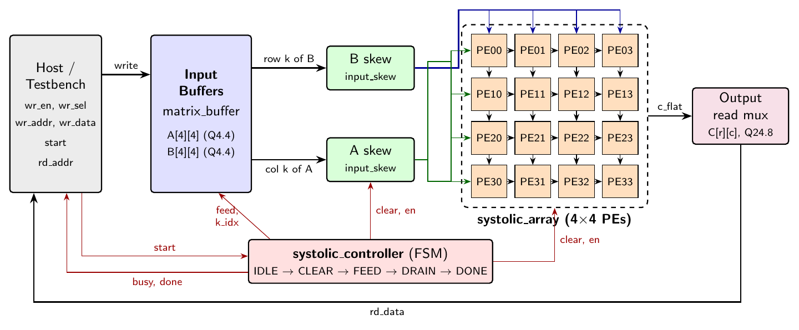
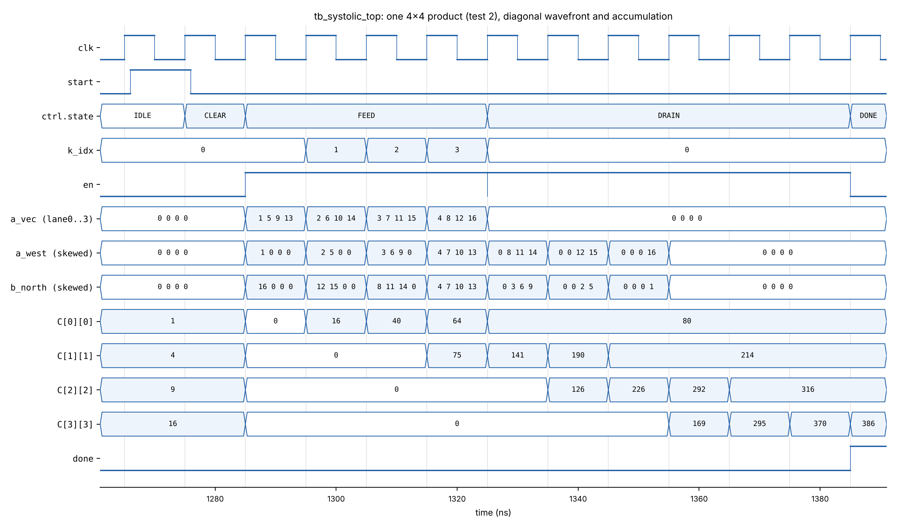

# Systolic Array Matrix Multiplication Accelerator

**CSA-222 Modern Computer Architecture: group project (Project 12)**
A parameterised **4×4 output-stationary systolic array** for signed fixed-point (Q4.4) matrix multiplication, written in synthesizable **Verilog-2005** and verified with **Icarus Verilog** and GTKWave. No hardware board is required.

| | |
|---|---|
| **Phase I report** | [`report/phase1_report.pdf`](report/phase1_report.pdf) (IEEE format, LaTeX source alongside) |
| **Prototype video** | **[Watch on Google Drive](https://drive.google.com/file/d/1_Fuetn23N6ReVL-TJW9B5vXp2K5eXfok/view?usp=sharing)** |
| **Team** | Harshvardhan Gupta (2401010185) · Harsha Gonela (2401010181) · Abhijeet Dey (2401010014) · Saumya Kumar (2401010432) · Shivansh Upadhayay (2401020109) |



---

## What it does

`C = A × B` for 4×4 matrices:

1. The host writes A and B into the **input buffers**, one element per cycle.
2. `start` → the **controller FSM** streams one column of A and one row of B per cycle.
3. The **skew buffers** stagger them into a diagonal wavefront.
4. Each **PE(i,j)** multiplies the operands passing through it and accumulates `C[i][j]` locally (output-stationary).
5. `done` → each `C[i][j]` is read out through `rd_addr` / `rd_data`.

| Parameter | Value |
|---|---|
| Array size `N` | 4 (parameterised; also tested at 3) |
| Operand format | signed Q4.4 (8 bit), range −8.0 … +7.9375 |
| Accumulator | signed Q24.8 (32 bit), overflow-free for N = 4 |
| Compute latency | 3N − 2 = 10 cycles (FEED + DRAIN) |
| start → done (observed) | 12 cycles |

## Repository layout

```
rtl/                     synthesizable RTL
  mac_unit.v             signed Q4.4 multiply + 32-bit accumulate      (Harshvardhan Gupta)
  pe.v                   processing element: MAC + forwarding regs      (Harsha Gonela)
  systolic_array.v       N×N PE grid (generate loops)                   (Abhijeet Dey)
  input_skew.v           diagonal skew buffers                          (Abhijeet Dey)
  matrix_buffer.v        A/B input buffers + matrix data interface      (Saumya Kumar)
  systolic_controller.v  IDLE/CLEAR/FEED/DRAIN/DONE FSM                 (Saumya Kumar)
  systolic_top.v         top level + output read mux                    (Saumya Kumar)
tb/                      self-checking testbenches (one per level)
model/golden_model.py    bit-exact Python reference + vector generator  (Shivansh Upadhayay)
tests/vectors/           generated $readmemh vectors + readable dump
sim/                     Makefile, run_all.sh / run_all.bat, GTKWave presets (*.gtkw)
docs/figures/            block, PE, dataflow, FSM and waveform figures (TikZ sources in src/)
docs/VIDEO_SCRIPT.md     Phase I video script and shot list
docs/PHASE2_ROADMAP.md   Phase II work plan per member
docs/COMMIT_PLAN.md      how each member commits their own work
report/                  IEEE report (LaTeX + PDF)
```

## Running the simulations

Requirements: Icarus Verilog (v12 or v13), Python 3, GTKWave (optional, for viewing waveforms).

```bash
cd sim
make all                 # or ./run_all.sh   (Windows: run_all.bat)
```

Expected output:

```
 RESULT: ALL 10 MAC TESTS PASSED
 RESULT: ALL 17 PE TESTS PASSED
 RESULT: ARRAY TESTS PASSED
 RESULT: ALL 8 SYSTEM TESTS PASSED
```

Individual targets: `make mac`, `make pe`, `make array`, `make top`, `make vectors`.
Waveforms: `gtkwave tb_systolic_top.vcd top.gtkw` (presets: `mac.gtkw`, `pe.gtkw`, `array.gtkw`, `top.gtkw`).

## Verification summary (Phase I)

| Testbench | What it checks | Result |
|---|---|---|
| `tb_mac_unit` | signed multiply, accumulate, hold, clear priority, Q4.4 fractions, extreme operands | 10/10 pass |
| `tb_pe` | 1-cycle forwarding, accumulation, freeze, clear, streamed dot product | 17/17 pass |
| `tb_systolic_array` | skew + array: A×I, signed A×B vs in-testbench reference | 2/2 pass |
| `tb_systolic_top` | full accelerator vs Python golden model: identity, signed, fractional, extreme, zero | 8/8 pass (128 elements) |



## Project status

- [x] **Phase I:** architecture, complete RTL, unit and system testbenches, golden model, IEEE report, video
- [ ] **Phase II:** performance counters and throughput analysis, sequential baseline and speed-up, double buffering and back-to-back streaming, tiling for larger matrices, requantisation and saturation, Vivado synthesis (utilisation and Fmax), random regression. See [`docs/PHASE2_ROADMAP.md`](docs/PHASE2_ROADMAP.md).

## References

The key sources are H. T. Kung, *Why systolic architectures?* (IEEE Computer, 1982); N. Jouppi et al., *In-datacenter performance analysis of a TPU* (ISCA 2017); and V. Sze et al., *Efficient processing of DNNs* (Proc. IEEE, 2017). The report has the full reference list.
